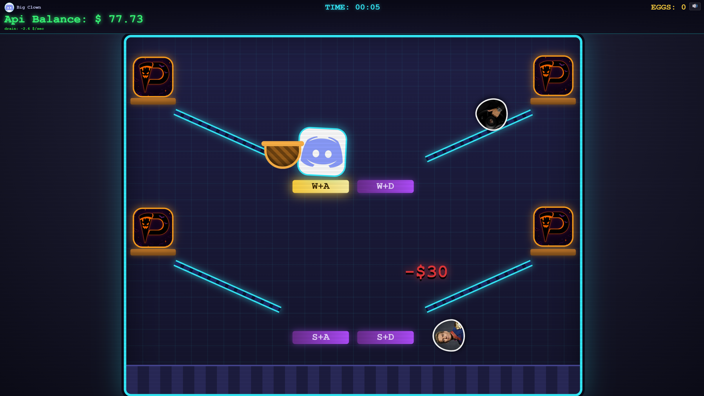

[English](README.md) | **Русский**

# Wolf Egg Catcher

> *Don't go broke!*

Браузерная аркада в духе классической «Ну, погоди!». Четыре курицы несут яйца, яйца катятся по желобам, а вы ловите их корзиной. Но есть подвох: ваш **API-баланс** тает каждую секунду, и пополнить его можно только пойманными яйцами. Баланс дошёл до нуля — игра окончена, а ваш результат — сколько секунд вы продержались.



## Особенности

- Четыре желоба и четыре позиции игрока; управление клавишами **W A S D** или экранными кнопками на телефоне
- Золотые яйца по $100 и постепенно растущая сложность
- Баланс непрерывно сгорает, причём всё быстрее; когда он падает ниже $20, края экрана наливаются красным
- Ник и собственный аватар (картинка с вашего устройства, обрезается до квадрата)
- Рекорд времени выживания сохраняется в браузере
- Звуки генерируются на лету через Web Audio API, аудиофайлов нет
- Поле масштабируется под размер окна, игра работает и на десктопе, и на мобильных устройствах
- Вся игра в одном `index.html` (плюс картинки-спрайты), без зависимостей и сборки

## Как играть

1. На стартовом экране нажмите **PLAY**, введите ник, при желании выберите аватар (**Change Avatar**) и нажмите **START GAME**.
2. Яйца скатываются по желобам от куриц к центру поля. Чтобы поймать яйцо, нужно в конце его пути стоять на «его» позиции — с той же стороны и на том же уровне (сверху или снизу), что и курица, которая это яйцо снесла.
3. Пойманное яйцо пополняет баланс, пропущенное разбивается и стоит **$30**.
4. Когда баланс достигнет нуля, игра закончится. Вы увидите время выживания, число пойманных яиц (в том числе золотых), максимальный баланс и общую сумму заработанного.

| Параметр | Значение |
|---|---|
| Стартовый баланс | $150 |
| Расход баланса | $2 в секунду в начале игры, дальше растёт |
| Обычное яйцо | $5–50 (чем дольше игра, тем дешевле) |
| Золотое яйцо | $100, выпадает примерно в 9 % случаев |
| Пропущенное яйцо | −$30 |

Сложность растёт со временем: яйца появляются чаще и катятся быстрее, а одновременно на желобах может быть до 10 яиц.

## Управление

Игрок стоит в одной из четырёх позиций (это углы воображаемого квадрата) и перемещается между ними:

| Клавиша | Действие |
|:---:|---|
| `W` | вверх |
| `S` | вниз |
| `A` | влево |
| `D` | вправо |
| `M` | включить / выключить звук |

Чтобы попасть в нужную позицию, достаточно двух клавиш (в любом порядке):

| | Лево | Право |
|---|:---:|:---:|
| **Верх** | `W` + `A` | `W` + `D` |
| **Низ** | `S` + `A` | `S` + `D` |

Клавиши работают и в русской раскладке (Ц, Ф, Ы, В). На сенсорных экранах (и в узких окнах браузера) внизу появляются кнопки ↖ ↙ ↗ ↘, которые переносят игрока сразу в нужную позицию.

## Запуск

Устанавливать ничего не нужно:

1. Скачайте репозиторий (**Code → Download ZIP**) или клонируйте его.
2. Откройте `index.html` в любом современном браузере.

При желании можно запустить локальный сервер:

```bash
python -m http.server 8000
```

и открыть http://localhost:8000.

## Настройка

Параметры баланса собраны в объекте `CFG` в начале скрипта в `index.html`:

| Параметр | По умолчанию | Описание |
|---|---|---|
| `startBalance` | `150` | стартовый баланс, $ |
| `penalty` | `30` | штраф за пропущенное яйцо, $ |
| `goldChance` | `0.09` | шанс золотого яйца |
| `goldValue` | `100` | стоимость золотого яйца, $ |
| `catchFrom` | `0.88` | доля пути, начиная с которой яйцо можно поймать (последние 12 %) |
| `drain(t)` | `2 + 0.08 * t + 0.01 * t ** 1.5` | расход баланса, $/сек (`t` — секунды с начала игры) |
| `spawnMs(t)` | `max(400, 1800 - 15 * t)` | пауза между яйцами, мс |
| `travelMs(t)` | `max(1000, 2500 - 16 * t)` | время, за которое яйцо катится по желобу, мс |
| `maxEggs(t)` | `3 → 5 → 7 → 10` | максимум одновременно катящихся яиц (ступени на 20-й, 40-й и 60-й секундах) |
| `eggValue(t)` | `5–50` | случайная стоимость обычного яйца, $ (со временем снижается) |

## Структура проекта

```text
.
├── index.html       вся игра: разметка, стили и скрипт
├── README.md        описание проекта (English)
├── README.ru.md     описание проекта (русский)
├── screenshot.png   скриншот для README
├── 1.png            обычное яйцо
├── 2.png            обычное яйцо
├── 3.png            золотое яйцо
├── 4.png            курица
├── 5.png            аватар игрока по умолчанию
└── 6.png            обычное яйцо
```

Любой спрайт можно заменить своим, сохранив имя файла. Если картинка не загрузилась, игра покажет вместо неё букву-заглушку и останется играбельной.

## Технологии

Чистые HTML, CSS и JavaScript, без фреймворков, зависимостей и сборки. Игровой цикл построен на `requestAnimationFrame`, звук на Web Audio API. Ник, аватар и рекорд хранятся в `localStorage` браузера (ключи `wec_nick`, `wec_avatar`, `wec_best`); чтобы сбросить рекорд, очистите данные сайта.
